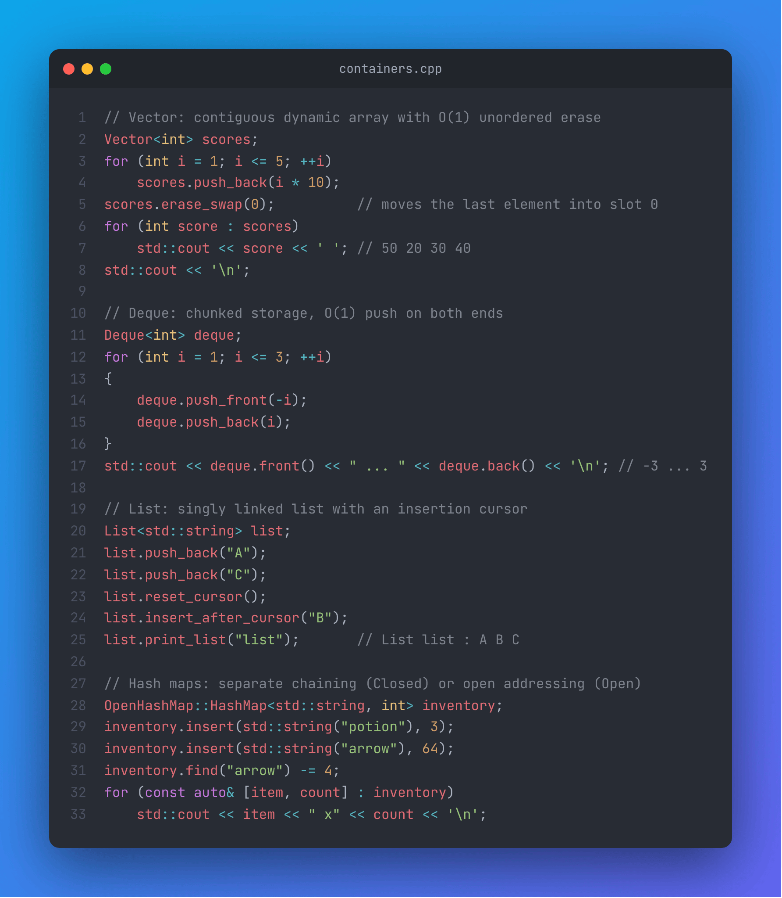
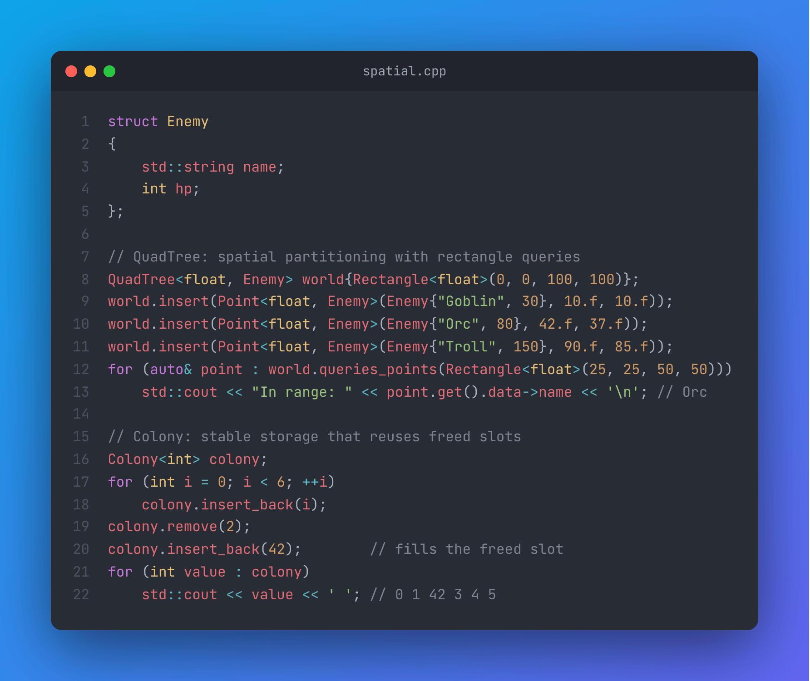

# Data-Structure

A **C++20** library of hand-written data structures: dynamic array, singly linked list, chunked deque, two hash map flavours, a quad tree and a colony. Each container is a small, readable, header-based template, written to understand how the standard containers work under the hood.


<p align="center">
  
  
</p>

---

## 📑 Table of Contents

- [Implemented Data Structures](#-implemented-data-structures)
- [Prerequisites](#-prerequisites)
- [Build](#-build)
- [Quick Example](#-quick-example)
- [Containers in Detail](#-containers-in-detail)
  - [Vector](#vector)
  - [List](#list)
  - [Deque](#deque)
  - [HashMap](#hashmap)
  - [QuadTree](#quadtree)
  - [Colony](#colony)
- [Project Structure](#-project-structure)

---

## 📦 Implemented Data Structures

| Container | Header | In short | Iterable |
| --- | --- | --- | :---: |
| `Vector<T>` | `Vector.h` | Contiguous dynamic array, growth ×2, O(1) unordered erase | ✅ |
| `List<T>` | `List.h` | Singly linked list with an insertion cursor | ❌ (`print_list`) |
| `Deque<T, MapSize, ChunkSize>` | `Deque.h` | Map of fixed-size chunks, O(1) push/pop on both ends, random access | ✅ |
| `ClosedHashMap::HashMap<K, V>` | `HashMap.h` | Hash table with separate chaining (one `std::list` per bucket) | ✅ |
| `OpenHashMap::HashMap<K, V>` | `HashMap.h` | Hash table with open addressing and tombstones | ✅ |
| `QuadTree<T, Data, Capacity>` | `QuadTree.h` | 2D spatial partitioning with rectangle queries | ❌ (`queries_points`) |
| `Colony<T, BlockSize>` | `Colony.h` | Linked blocks of slots, removed slots are reused, elements never move | ✅ |

All containers follow the rule of five with the copy-and-swap idiom (copy constructor, assignment by value, `friend swap`).

---

## 🚀 Prerequisites

* A C++20 compiler (GCC, Clang, MSVC)
* [CMake](https://cmake.org/) (the `CMakeLists.txt` asks for **4.0**)

---

## 🔨 Build

```bash
git clone https://github.com/Xanhos/Data-Structure.git
cd Data-Structure
cmake -B build
cmake --build build
./build/bin/TestDataStructure
```

This builds:

* `DataStructure`: a static library exposing the `header/` folder,
* `TestDataStructure`: the demo program in `main.cpp`, which exercises every container.

To use the library in another CMake project:

```cmake
add_subdirectory(Data-Structure)
target_link_libraries(MyProject PRIVATE DataStructure)
```

Or simply add the `header/` folder to your include paths: every container is a template implemented in its header.

---

## ⚡ Quick Example

```cpp
#include <iostream>
#include <string>

#include "Vector.h"
#include "Deque.h"
#include "HashMap.h"
#include "QuadTree.h"
#include "Colony.h"

struct Enemy
{
    std::string name;
    int hp;
};

int main()
{
    // Vector: contiguous dynamic array with O(1) unordered erase
    Vector<int> scores;
    for (int i = 1; i <= 5; ++i)
        scores.push_back(i * 10);
    scores.erase_swap(0);          // moves the last element into slot 0
    for (int score : scores)
        std::cout << score << ' '; // 50 20 30 40

    // Deque: chunked storage, O(1) push on both ends
    Deque<int> deque;
    for (int i = 1; i <= 3; ++i)
    {
        deque.push_front(-i);
        deque.push_back(i);
    }
    std::cout << deque.front() << " ... " << deque.back() << '\n'; // -3 ... 3

    // Hash map with open addressing
    OpenHashMap::HashMap<std::string, int> inventory;
    inventory.insert(std::string("potion"), 3);
    inventory.insert(std::string("arrow"), 64);
    inventory.find("arrow") -= 4;
    for (const auto& [item, count] : inventory)
        std::cout << item << " x" << count << '\n';

    // QuadTree: spatial partitioning with rectangle queries
    QuadTree<float, Enemy> world{Rectangle<float>(0, 0, 100, 100)};
    world.insert(Point<float, Enemy>(Enemy{"Goblin", 30}, 10.f, 10.f));
    world.insert(Point<float, Enemy>(Enemy{"Orc", 80}, 42.f, 37.f));
    world.insert(Point<float, Enemy>(Enemy{"Troll", 150}, 90.f, 85.f));
    for (auto& point : world.queries_points(Rectangle<float>(25, 25, 50, 50)))
        std::cout << "In range: " << point.get().data->name << '\n'; // Orc

    // Colony: stable storage that reuses freed slots
    Colony<int> colony;
    for (int i = 0; i < 6; ++i)
        colony.insert_back(i);
    colony.remove(2);
    colony.insert_back(42);        // fills the freed slot
    for (int value : colony)
        std::cout << value << ' '; // 0 1 42 3 4 5
}
```

---

## 🔍 Containers in Detail

### Vector

`Vector<T>` owns a raw buffer and constructs elements in place. It starts with a capacity of 3 and doubles when full.

| Method | Description |
| --- | --- |
| `push_back(value)` | Appends (perfect forwarding). |
| `pop_back()` | Removes the last element. |
| `erase_swap(index)` | Swaps the element with the last one, then removes it: O(1), order not preserved. |
| `resize(count, init = T())` | Grows or shrinks the vector. |
| `reserve(n)` / `shrink_to_fit()` | Manages the capacity. |
| `clear()` | Destroys every element. |
| `operator[](index)` | Bounds-checked access (throws `std::out_of_range`). |
| `get_size()` / `get_capacity()` / `is_empty()` | Queries. |
| `begin()` / `end()` | Random-access iterators (const and non-const). |

### List

`List<T>` is a singly linked list. A **cursor** lets you insert in the middle without walking the list each time.

| Method | Description |
| --- | --- |
| `push_back(value)` | Appends and returns a pointer to the stored element. |
| `reset_cursor()` / `move_forward_cursor()` | Moves the cursor to the head / the next node. |
| `insert_after_cursor(value)` | Inserts right after the cursor. |
| `print_list("name")` | Prints the content, e.g. `List name : A B C`. |
| `reset()` | Deletes every node. |

### Deque

`Deque<T, DequeSize_ = 100, ChunkSize_ = 8>` keeps a fixed-size map of pointers to chunks of `ChunkSize_` elements. Pushing on either side fills the current chunk or allocates a neighbouring one, so existing elements never move.

| Method | Description |
| --- | --- |
| `push_back(value)` / `push_front(value)` | O(1) insertion at both ends. |
| `pop_back()` / `pop_front()` | O(1) removal at both ends. |
| `front()` / `back()` | Access (throws if empty). |
| `get_at(index)` / `operator[](index)` | Random access. |
| `size()` / `is_empty()` | Queries. |
| `begin()` / `end()` | Random-access iterators. |

> The map size is fixed: the deque can hold at most `DequeSize_ × ChunkSize_` elements in total (800 with the defaults), `std::bad_alloc` is thrown beyond that. Increase the template parameters for bigger deques.

### HashMap

Two implementations with the same interface, both based on `std::hash<K>` and starting with 10 buckets:

| | `ClosedHashMap::HashMap<K, V>` | `OpenHashMap::HashMap<K, V>` |
| --- | --- | --- |
| Collisions | Separate chaining: each bucket is a `std::list<std::pair<K, V>>` | Open addressing: probe the next cells |
| Removal | Erase from the bucket list | Mark the cell as `TRASH` (tombstone) |
| Growth | Manual `rehash()` (doubles the bucket count) | Automatic `rehash()` when the table is full |

| Method | Description |
| --- | --- |
| `insert(key, value)` | Inserts or updates. |
| `find(key)` | Returns `V&`, throws `std::out_of_range` if the key is missing. |
| `remove(key)` | Removes the entry. |
| `rehash()` | Doubles the table size and re-inserts every entry. |
| `begin()` / `end()` | Iterates over `std::pair<K, V>` (structured bindings friendly). |

### QuadTree

`QuadTree<Ty_, Data_ = void, QuadLimits_ = 16>` stores `Point<Ty_, Data_>` (coordinates + an owned copy of `Data_`) inside a `Rectangle<Ty_>` boundary. A node splits into four children (`northWest`, `northEast`, `southWest`, `southEast`) once it holds `QuadLimits_` points.

| Method | Description |
| --- | --- |
| `QuadTree(Rectangle<T>{x, y, w, h})` | Creates the tree over a boundary. |
| `insert(Point)` | Inserts a point, returns `false` if it is outside the boundary. |
| `get_at(Point)` | Returns the point stored at these coordinates (`std::optional<std::reference_wrapper<Point>>`). |
| `queries_points(Rectangle)` | Returns every point inside a rectangle, only visiting intersecting nodes. |
| `size()` | Number of points in the whole tree. |

`Rectangle::contains` and `Rectangle::intersect` are constrained with concepts (`IsAPoint`, `IsARect`), so any type exposing `x`/`y` (and `width`/`height` or `w`/`h`) can be used for queries.

### Colony

`Colony<Ty_, BlockSize_ = 16>` is a linked list of blocks of `BlockSize_` cells. Removing an element only frees its cell; the next insertion reuses the first free cell, so **pointers to the other elements stay valid**. Each block tracks skip ranges over free cells to keep iteration fast.

| Method | Description |
| --- | --- |
| `insert_back(value)` | Inserts in the first free cell (or a new block). |
| `remove(index)` | Frees the cell of the `index`-th element. |
| `get_at(index)` | Access by logical index. |
| `size()` | Number of live elements. |
| `begin()` / `end()` | Forward iterators skipping free cells. |

---

## 📂 Project Structure

```text
Data-Structure/
├── header/              # Container templates
│   ├── Vector.h
│   ├── List.h
│   ├── Deque.h
│   ├── HashMap.h        # ClosedHashMap + OpenHashMap
│   ├── QuadTree.h       # Point, Rectangle, QuadTree
│   └── Colony.h
├── source/              # Translation units of the static library
├── cmake/Utils.cmake    # FetchContent helper
├── main.cpp             # Demo of every container
└── CMakeLists.txt
```
